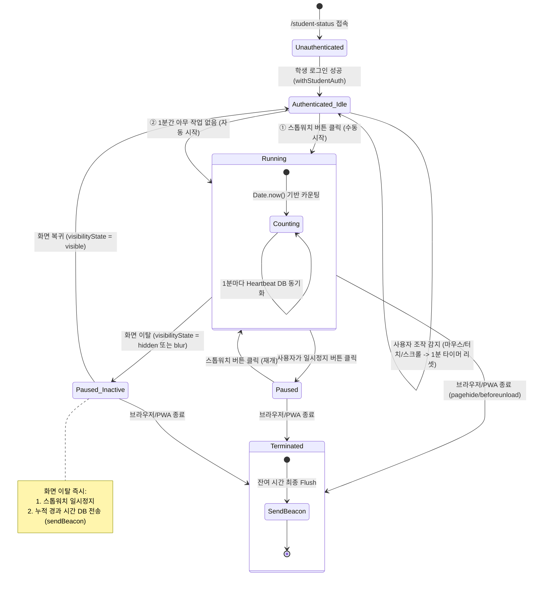
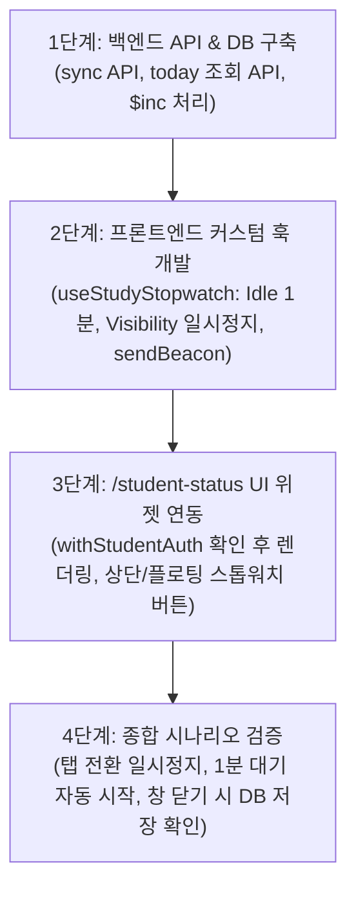

# ⏱️ [기획서] 학생 학습 시간 스톱워치 트래킹 시스템 설계서

> **문서 상태**: 요구사항 반영 완료 (Specification & Architecture Plan)  
> **대상 화면**: `/student-status` (학생 성취도 및 출석 현황 페이지)  
> **핵심 원칙**: 
> 1. **인증 연동**: 로그인 완료 시에만 동작 (비로그인 시 비활성화)
> 2. **수동 + 자동 시작**: 스톱워치 버튼 제공 및 **1분간 무작업(Idle) 시 자동 시작**
> 3. **화면 이탈 시 일시정지**: 다른 탭/창 전환, 백그라운드 전환 시 **즉시 측정 일시정지 & 중간 시간 전송**
> 4. **종료 시 DB 저장**: 브라우저 닫기/PWA 스와이프 종료 시 `navigator.sendBeacon`으로 유실 없는 저장

---

## 1. 개요 및 요구사항 정의

### 1.1 배경 및 목적
- 학생이 `/student-status` 페이지에서 공부를 하거나 과제/학습 리포트를 확인하며 머무는 시간을 정확하게 측정합니다.
- 학생이 직접 스톱워치를 누르지 않더라도 화면을 켜두고 공부에 집중할 때(1분 동안 인터랙션이 없을 때) 자동으로 시간을 기록하고, 화면을 이탈하여 딴짓을 하거나 탭을 닫으면 즉시 측정을 멈추고 안전하게 DB에 저장합니다.

### 1.2 핵심 요구사항

| 구분 | 요구사항 | 상세 동작 |
| :--- | :--- | :--- |
| **인증 연동** | `/student-status` 로그인 시에만 작동 | • `withStudentAuth` 인증 완료 후 `studentAuthData`가 유효할 때만 스톱워치 활성화<br>• 비로그인(전화번호/이름 입력 화면) 및 로그아웃 시 스톱워치/타이머 완전 비활성화 |
| **수동 조작** | 스톱워치 버튼 제공 | • 화면 상단 또는 플로팅 바에 [시작 / 일시정지] 토글 버튼 배치<br>• 현재 세션 측정 시간(`00:23:45`) 및 오늘 총 누적 시간 실시간 노출 |
| **자동 시작** | 1분 무작업 시 자동 시작 (Idle Auto-Start) | • 마우스/키보드/터치/스크롤이 **1분(60초)간 없을 경우** 자동으로 스톱워치 시작<br>• "집중 학습 시간이 측정 중입니다" 상태 안내 |
| **화면 이탈 일시정지** | 화면에서 벗어나면 측정 일시정지 | • 탭 전환, 창 최소화, 모바일 앱 백그라운드 전환, 타 페이지 이동 감지<br>• **즉시 스톱워치 일시정지(Pause)** 및 현재까지의 경과 시간 즉시 전송 |
| **종료 시 DB 저장** | 웹/PWA 종료 시 DB 저장 보장 | • `navigator.sendBeacon` 및 `fetch(keepalive: true)`를 이용해 브라우저 종료 시에도 소켓 끊김 없이 MongoDB에 누적 초($inc) 반영 |

---

## 2. 상태 전이 모델 (State Machine)



---

## 3. 핵심 기능별 상세 설계

### 3.1 로그인 연동 및 대상 검증
- **검증 위치**: `components/studentStatus/StudentStatusContent.tsx`
- **조건**:
  - `withStudentAuth`를 통해 검증된 `studentAuthData?.studentId`가 존재하는 경우에만 `useStudyStopwatch` 훅이 작동합니다.
  - 학생 본인(`target === 'student'`)일 때만 활성화하거나, 필요에 따라 전체 로그인 사용자에게 적용할 수 있도록 옵션화합니다.
  - 컴포넌트 마운트 시 오늘 날짜의 기존 누적 학습 시간을 백엔드에서 조회하여 초기 표시합니다.

### 3.2 스톱워치 버튼 (UI 컴포넌트)
- **배치 위치**: 
  - 학생 상태 상단 카드 영역(`StudentStatusContent` 상단) 또는 우측 하단 미니 플로팅 위젯
- **표시 정보**:
  1. **상태 배지**: 
     - 🟢 `학습 중 (자동 시작됨)` / 🟢 `학습 중 (수동)` / 🟡 `일시정지 (화면 벗어남)` / ⚪ `대기 중`
  2. **현재 세션 시간**: `00:15:23` (이번 세션에 집중한 시간)
  3. **오늘 총 누적 시간**: `오늘 총 2시간 15분` (DB에 기록된 누적합 + 현재 세션)
  4. **액션 버튼**:
     - 시작/일시정지 토글 버튼 (PrimeReact `Button`: `pi-play` / `pi-pause`)
     - (옵션) 수동 저장 버튼

### 3.3 1분 무작업 감지 엔진 (Idle Auto-Start)
- **감지 대상 이벤트**:
  - 마우스: `mousemove`, `mousedown`, `wheel`
  - 키보드: `keydown`, `keyup`
  - 모바일 터치: `touchstart`, `touchmove`
  - 브라우저: `scroll`
- **동작 방식**:
  1. 사용자가 페이지 내에서 활동하면 60초 타이머(`idleTimerRef`)가 계속 리셋됩니다 (성능을 위해 이벤트는 500ms 단위로 throttle 처리).
  2. 마지막 활동 시점으로부터 **정확히 60초(1분) 동안 아무런 조작이 없으면**:
     - 현재 스톱워치가 멈춰있는 상태(`!isRunning`)라면 **자동으로 스톱워치를 시작**합니다.
     - 사용자가 화면을 켜둔 채 문제지를 풀거나 인강/책을 보는 집중 학습 상태로 판별합니다.
  3. **사용자가 다시 조작을 시작할 때의 정책**:
     - 스톱워치는 **계속해서 실행 상태를 유지**합니다 (학습 중 잠깐 화면을 스크롤하거나 클릭했다고 꺼지지 않음).
     - 원할 때는 사용자가 직접 [일시정지] 버튼을 눌러 정지할 수 있습니다.

### 3.4 화면 이탈 감지 및 자동 일시정지 (Visibility Auto-Pause)
- **감지 이벤트**:
  - `document.addEventListener('visibilitychange')`: 탭 전환, 브라우저 최소화, 스마트폰 화면 끄기, 홈 화면 전환
  - `window.addEventListener('blur')`: 다른 모니터나 다른 프로그램 창으로 포커스가 넘어갈 때
  - Next.js 컴포넌트 `unmount`: 다른 메뉴 라우트로 이동할 때
- **이탈 시 처리 순서**:
  1. `document.visibilityState === 'hidden'` 또는 `blur` 발생 즉시 스톱워치를 **일시정지(`isPaused = true`)** 처리.
  2. 마지막 동기화 시점 이후 누적된 경과 시간(Delta 초)을 즉시 계산.
  3. 계산된 시간을 `navigator.sendBeacon` (또는 `fetch(keepalive: true)`)으로 백엔드에 즉각 전송하여 저장.
  4. 타이머 틱 중단(더 이상 백그라운드에서 시간이 카운트되지 않음).
- **화면 복귀 시 처리 순서**:
  - `document.visibilityState === 'visible'` 복귀 시:
    - 상태를 `대기 중(일시정지)`으로 유지하며, 사용자가 다시 화면에 돌아왔으므로 1분 무작업 타이머를 재가동합니다 (또는 수동 시작 버튼 활성화).

### 3.5 종료 시 DB 저장 보장 (Beacon & Heartbeat)
- **1분 주기 정기 저장 (Heartbeat)**:
  - 스톱워치가 작동 중일 때 1분(60초)마다 백엔드에 `duration: 60`을 전송하여 `$inc`로 누적.
  - PC가 갑자기 꺼지거나 앱이 크래시되어도 최대 유실 시간을 1분 이내로 제한.
- **종료 시점 최종 Flush**:
  - `visibilitychange`, `pagehide`, `beforeunload` 발생 시 마지막 정기 저장 이후의 나머지 초(예: 42초)를 `navigator.sendBeacon`으로 백엔드 전송.

---

## 4. 프론트엔드 상세 아키텍처

### 4.1 커스텀 훅: `useStudyStopwatch.ts`
```typescript
import { useState, useEffect, useRef, useCallback } from 'react';

interface UseStudyStopwatchProps {
    studentId?: string;
    isAuthorized: boolean;
    idleTimeoutMs?: number; // 기본값 60,000ms (1분)
}

export const useStudyStopwatch = ({
    studentId,
    isAuthorized,
    idleTimeoutMs = 60000
}: UseStudyStopwatchProps) => {
    const [isRunning, setIsRunning] = useState(false);
    const [currentSessionSeconds, setCurrentSessionSeconds] = useState(0);
    const [todayTotalSeconds, setTodayTotalSeconds] = useState(0);
    const [statusLabel, setStatusLabel] = useState<'IDLE' | 'RUNNING' | 'PAUSED_AWAY'>('IDLE');

    const startTimeRef = useRef<number | null>(null);
    const accumulatedSessionRef = useRef<number>(0);
    const lastSyncTimeRef = useRef<number>(Date.now());
    const idleTimerRef = useRef<NodeJS.Timeout | null>(null);
    const heartbeatTimerRef = useRef<NodeJS.Timeout | null>(null);
    const tickTimerRef = useRef<NodeJS.Timeout | null>(null);

    // 1. 백엔드로 시간 전송 (Beacon / Keepalive)
    const syncTimeToServer = useCallback((seconds: number) => {
        if (!studentId || seconds <= 0) return;

        const payload = JSON.stringify({
            studentId,
            durationSeconds: seconds,
            timestamp: new Date().toISOString()
        });

        const url = `${process.env.NEXT_PUBLIC_BACKEND_URL}/choiMath/study-time/sync`;
        const blob = new Blob([payload], { type: 'application/json' });

        if (typeof navigator !== 'undefined' && navigator.sendBeacon) {
            navigator.sendBeacon(url, blob);
        } else {
            fetch(url, {
                method: 'POST',
                headers: { 'Content-Type': 'application/json' },
                body: payload,
                keepalive: true
            }).catch(() => {});
        }
    }, [studentId]);

    // 2. 누적 잔여 시간 즉시 Flush
    const flushRemainingTime = useCallback(() => {
        if (!isRunning || !startTimeRef.current) return;

        const now = Date.now();
        const deltaSeconds = Math.floor((now - lastSyncTimeRef.current) / 1000);

        if (deltaSeconds > 0) {
            syncTimeToServer(deltaSeconds);
            setTodayTotalSeconds((prev) => prev + deltaSeconds);
            lastSyncTimeRef.current = now;
        }
    }, [isRunning, syncTimeToServer]);

    // 3. 스톱워치 시작 함수
    const start = useCallback(() => {
        if (!isAuthorized || !studentId) return;
        setIsRunning(true);
        setStatusLabel('RUNNING');
        startTimeRef.current = Date.now();
        lastSyncTimeRef.current = Date.now();
    }, [isAuthorized, studentId]);

    // 4. 스톱워치 일시정지 함수
    const pause = useCallback((reason: 'MANUAL' | 'AWAY' = 'MANUAL') => {
        flushRemainingTime();
        setIsRunning(false);
        setStatusLabel(reason === 'AWAY' ? 'PAUSED_AWAY' : 'IDLE');
        startTimeRef.current = null;
    }, [flushRemainingTime]);

    // 5. 1분 무작업 감지 리셋 핸들러
    const resetIdleTimer = useCallback(() => {
        if (!isAuthorized || !studentId) return;

        if (idleTimerRef.current) {
            clearTimeout(idleTimerRef.current);
        }

        // 1분간 아무 동작 없으면 자동 시작
        idleTimerRef.current = setTimeout(() => {
            if (!isRunning && document.visibilityState === 'visible') {
                start();
            }
        }, idleTimeoutMs);
    }, [isAuthorized, studentId, isRunning, idleTimeoutMs, start]);

    // 6. 사용자 활동 이벤트 등록 (Throttle 적용)
    useEffect(() => {
        if (!isAuthorized || !studentId) return;

        let lastActivity = 0;
        const handleUserActivity = () => {
            const now = Date.now();
            if (now - lastActivity > 500) { // 500ms 쓰로틀
                lastActivity = now;
                resetIdleTimer();
            }
        };

        const events = ['mousemove', 'mousedown', 'keydown', 'touchstart', 'scroll'];
        events.forEach((ev) => window.addEventListener(ev, handleUserActivity, { passive: true }));
        resetIdleTimer(); // 초기 타이머 가동

        return () => {
            events.forEach((ev) => window.removeEventListener(ev, handleUserActivity));
            if (idleTimerRef.current) clearTimeout(idleTimerRef.current);
        };
    }, [isAuthorized, studentId, resetIdleTimer]);

    // 7. 화면 이탈 감지 (visibilitychange / blur) 시 자동 일시정지
    useEffect(() => {
        if (!isAuthorized || !studentId) return;

        const handleVisibilityChange = () => {
            if (document.visibilityState === 'hidden') {
                // 화면에서 벗어나면 즉시 일시정지 및 저장!
                if (isRunning) {
                    pause('AWAY');
                }
                if (idleTimerRef.current) clearTimeout(idleTimerRef.current);
            } else if (document.visibilityState === 'visible') {
                // 화면 복귀 시 무작업 감지 타이머 재개
                resetIdleTimer();
            }
        };

        const handlePageHide = () => {
            flushRemainingTime();
        };

        document.addEventListener('visibilitychange', handleVisibilityChange);
        window.addEventListener('pagehide', handlePageHide);
        window.addEventListener('beforeunload', handlePageHide);

        return () => {
            document.removeEventListener('visibilitychange', handleVisibilityChange);
            window.removeEventListener('pagehide', handlePageHide);
            window.removeEventListener('beforeunload', handlePageHide);
            flushRemainingTime();
        };
    }, [isAuthorized, studentId, isRunning, pause, flushRemainingTime, resetIdleTimer]);

    // 8. 1초 단위 UI 카운팅 & 1분 주기 Heartbeat 저장
    useEffect(() => {
        if (isRunning) {
            tickTimerRef.current = setInterval(() => {
                if (startTimeRef.current) {
                    const elapsed = Math.floor((Date.now() - startTimeRef.current) / 1000);
                    setCurrentSessionSeconds(accumulatedSessionRef.current + elapsed);
                }
            }, 1000);

            heartbeatTimerRef.current = setInterval(() => {
                flushRemainingTime();
            }, 60000); // 1분마다 정기 동기화
        } else {
            if (tickTimerRef.current) clearInterval(tickTimerRef.current);
            if (heartbeatTimerRef.current) clearInterval(heartbeatTimerRef.current);
        }

        return () => {
            if (tickTimerRef.current) clearInterval(tickTimerRef.current);
            if (heartbeatTimerRef.current) clearInterval(heartbeatTimerRef.current);
        };
    }, [isRunning, flushRemainingTime]);

    return {
        isRunning,
        currentSessionSeconds,
        todayTotalSeconds,
        statusLabel,
        start,
        pause
    };
};
```

---

## 5. 백엔드 API 및 DB 스키마 설계 (`vercel_backend`)

### 5.1 MongoDB 컬렉션 스키마 (`study_time_log`)
- 학생별, 일자별로 하나의 문서를 유지하여 빠른 집계와 안전한 원자적 증분(`$inc`)을 지원합니다.

```javascript
{
  "_id": ObjectId("67..."),
  "studentId": "65b...",               // 학생 고유 식별자 (ObjectId string)
  "date": "2026-10-19",                // YYYY-MM-DD
  "totalSeconds": 4820,                // 오늘 총 누적 학습 시간(초)
  "autoStartedCount": 5,               // 1분 무작업으로 자동 시작된 횟수
  "manualStartedCount": 2,             // 사용자가 수동 버튼으로 시작한 횟수
  "lastSyncedAt": ISODate("2026-10-19T12:30:15Z"),
  "updatedAt": ISODate("2026-10-19T12:30:15Z")
}
```

### 5.2 API 엔드포인트

#### 1) 시간 동기화 (`POST /choiMath/study-time/sync`)
- **특징**: `sendBeacon` 호출 지원 (헤더 파싱 유연화)
- **로직**:
```javascript
const syncStudyTime = async (req, res) => {
  try {
    let body = req.body;
    // sendBeacon으로 text/plain 또는 Blob이 올 경우 안전한 파싱
    if (typeof body === 'string') {
      try { body = JSON.parse(body); } catch (e) {}
    }

    const { studentId, durationSeconds } = body;
    if (!studentId || !durationSeconds || durationSeconds <= 0) {
      return res.status(200).json({ success: false, message: 'Invalid payload' });
    }

    const today = dayjs().format('YYYY-MM-DD');
    const collection = await getCollection('study_time_log');

    await collection.updateOne(
      { studentId, date: today },
      {
        $inc: { totalSeconds: Number(durationSeconds) },
        $set: { lastSyncedAt: new Date(), updatedAt: new Date() }
      },
      { upsert: true }
    );

    return res.status(200).json({ success: true });
  } catch (error) {
    console.error('Error syncing study time:', error);
    return res.status(500).json({ error: error.message });
  }
};
```

#### 2) 오늘 누적 시간 조회 (`GET /choiMath/study-time/today?studentId=...`)
- `/student-status` 진입 시 오늘 이미 기록된 총 누적 시간을 로드하여 화면에 즉시 바인딩.

---

## 6. 개발 단계별 구현 계획 (Milestones)



1. **1단계 (백엔드 `vercel_backend`)**:
   - `study_time_log` 컬렉션 인덱스(`studentId + date`) 설정
   - `studyTimeRouter.js` 및 `studyTimeService.js` 작성 (`/sync`, `/today`)
2. **2단계 (프론트엔드 코어 `next_admin`)**:
   - `hooks/useStudyStopwatch.ts` 구현 (1분 무작업 감지, `visibilitychange` 일시정지, 종료 시 Beacon 전송)
3. **3단계 (UI 컴포넌트 `next_admin`)**:
   - `components/studentStatus/StudyStopwatchWidget.tsx` 작성
   - `StudentStatusContent.tsx` 상단에 배치 (`isAuthorized && studentAuthData` 확인)
4. **4단계 (크로스 브라우징 및 검증)**:
   - 1분 무작업 시 자동 시작 동작 확인
   - 다른 탭 이동 시 즉시 일시정지 및 DB 시간 증가 확인
   - 브라우저 종료 시 Beacon 전송 및 데이터 무결성 검증
